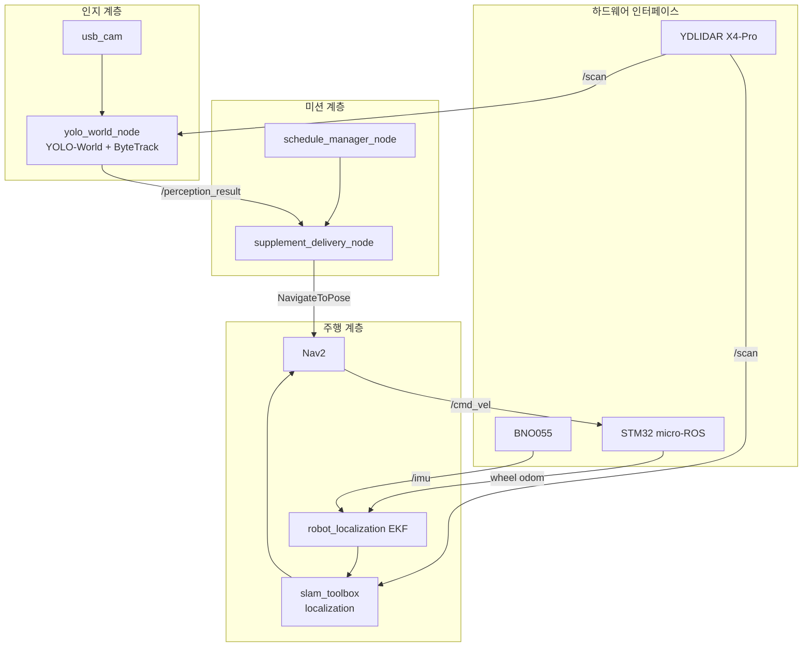

# 영양제 배달 AMR (Supplement Delivery Rover)

1인 가구를 위한 자율주행 영양제 배달 로버입니다.
정해진 시간이 되면 집 안에서 사용자를 찾아가 영양제를 전달합니다.

- **저수준 제어**: STM32 NUCLEO-F401RE + micro-ROS (모터 PID, 엔코더, 조향 서보)
- **고수준 연산**: Jetson AGX Orin + ROS 2 Humble (SLAM, Nav2, 인지, 미션)
- **인지**: YOLO-World + ByteTrack 으로 사람을 찾고, 2D LiDAR로 거리를 측정해 융합

---

## 시스템 구성



### TF 트리
```
map ─(slam_toolbox)→ odom ─(EKF)→ base_link ─┬─(static)→ laser_frame
                                              └─(static)→ bno055
```

---

## 하드웨어

| 구성 | 부품 |
|---|---|
| 메인 컴퓨터 | NVIDIA Jetson AGX Orin (MODE_30W) |
| MCU | STM32 NUCLEO-F401RE |
| 구동 | Ackermann 구조 (축거 L=175mm, 윤거 T=200mm), 후륜 구동 + 전륜 서보 조향 |
| 모터 | RB35GM 엔코더 모터 ×2 (1/50 감속, 4체배 기준 5200 count/rev) |
| 모터 드라이버 | L298N (WB291111) |
| LiDAR | YDLIDAR X4-Pro (2D) |
| IMU | BNO055 (I2C) |
| 카메라 | USB 카메라 |
| 전원 | Jetson / 모터 드라이버 전원 분리 (모터: 60W PD + 12V 트리거) |

---

## 레포 구조

```
rover_amr/
├── firmware/              # STM32CubeIDE 프로젝트 (micro-ROS)
├── ros2_ws/src/
│   └── yolo_perception/   # 인지 + 미션 노드, launch
├── config/                # ekf, slam_toolbox, nav2 파라미터, BT xml, 웨이포인트
├── maps/                  # slam_toolbox 지도 (pgm/yaml/posegraph/data)
├── scripts/               # wheel_odom_relay, 캘리브레이션 도구
└── docs/                  # 블로그 글, 다이어그램
```

---

## 설치

### 1. 의존성 (Jetson, ROS 2 Humble)
```bash
sudo apt install ros-humble-navigation2 ros-humble-nav2-bringup \
                 ros-humble-slam-toolbox ros-humble-robot-localization \
                 ros-humble-usb-cam
```
별도 빌드가 필요한 패키지:
- [micro-ROS agent](https://github.com/micro-ROS/micro_ros_setup)
- [ydlidar_ros2_driver](https://github.com/YDLIDAR/ydlidar_ros2_driver)
- [bno055 ROS 2 driver](https://github.com/flynneva/bno055)

### 2. YOLO venv
```bash
python3 -m venv ~/yolo_venv --system-site-packages
~/yolo_venv/bin/pip install ultralytics
```
모델 가중치(`*.pt`)는 레포에 포함하지 않습니다. 첫 실행 시 ultralytics가 자동으로 내려받습니다.

### 3. 빌드
```bash
cd ros2_ws
colcon build --symlink-install
```

### 4. 펌웨어
`firmware/`를 STM32CubeIDE로 열어 빌드 후 NUCLEO에 업로드합니다.
micro-ROS 정적 라이브러리는 레포에 없으므로 처음 한 번 빌드가 필요합니다 ([firmware/README](firmware/README.md) 참고).

---

## 실행

```bash
source /opt/ros/humble/setup.bash
source <각 워크스페이스>/install/setup.bash

# 전체 스택
ros2 launch ./full_stack.launch.py

# 주행 스택만 (인지·미션 제외)
ros2 launch ./full_stack.launch.py use_perception:=false use_mission:=false
```

| 시점 | 기동 대상 |
|---|---|
| 0s | micro-ROS agent, LiDAR, BNO055, IMU TF, wheel odom relay, EKF |
| 3s | slam_toolbox (localization) |
| 8s | Nav2 |
| 10s | 카메라, YOLO-World |
| 15s | schedule manager, supplement delivery |

기동 후 RViz의 **2D Pose Estimate**로 초기 위치를 지정해야 합니다.

---

## 핵심 설계

### 오도메트리 & 위치 추정
- 엔코더 홀 센서가 오픈 컬렉터 출력이라 풀업 필요
- 좌측 엔코더 불량 → **우측 엔코더 + Ackermann 기하**로 중심 속도 역산
  `v_center = v_right × R / (R + T/2)`, `R = L / tan(δ)`
- EKF: 휠 오도메트리는 `vx`만, `yaw` / `yaw_rate`는 BNO055에서 (캘리브레이션 sys=3)
- slam_toolbox localization 모드, 해상도 0.02m, 여러 바퀴 주행으로 루프 클로저를 확보한 지도 사용

### 모터 제어
- 우측 엔코더 기반 단일 PID를 양쪽 모터에 공통 적용 (Ki=0.6, Kd=0.02, 데드존 PWM 3200)
- 전원 분리 후 breakaway 보상 로직 제거

### 인지 융합 (카메라 + LiDAR)
- YOLO-World로 `person` 검출, ByteTrack으로 트랙 ID 유지
- 박스 중심 각도 → LiDAR 각도로 변환해 해당 방향의 거리 측정
  - LiDAR raw: 0° = 후방, 180° = 전방, +90° = 좌측
  - 매핑: `lidar_angle = 180 + camera_angle`
- 카메라-LiDAR 외부 파라미터 (최소제곱 캘리브레이션):
  `dx = 0.0801 m, dy = -0.0084 m, θ = -1.51°` (RMS 1.087°)
- 출력 토픽 `/perception_result` 형식:
  `cls|angle|dist|stamp_sec|stamp_nanosec|track_id`
- 검출 시점의 stamp로 TF를 조회해 이동 중에도 목표 위치를 map 좌표로 변환

### 미션 상태 머신
```
IDLE → SEARCHING_LOCAL → SEARCHING_WAYPOINT → MOVING → DISPENSING
```
- 제자리 탐색 실패 시 웨이포인트(`living_room`, `bedroom`)를 순회
- 첫 검출을 신뢰하고 이동 중 재확인은 하지 않음
- Nav2 결과는 `GoalStatus.STATUS_SUCCEEDED`로 확인

### Nav2 튜닝
- `approach_distance 0.8m`, `yaw_goal_tolerance 3.14` (사람 앞 도착이 목적, 방향은 무관)
- BT BackUp 복구: `backup_dist=0.40, backup_speed=0.15`

---

## 알려진 이슈

- [ ] 좌측 엔코더 하드웨어 불량
- [ ] 같은 프레임에 person 박스가 중복 검출되고, LiDAR 검색창(±12.6°)이 겹쳐 거리를 공유함
- [ ] `filter_distance` 이력이 트랙 간에 공유됨 (트랙별 분리 필요)
- [ ] 사람 앞에 장애물이 있으면 `min()`이 장애물 거리를 선택함
- [ ] YOLO 추론이 CPU 단일 코어 병목 → TensorRT 전환 검토
- [ ] STM32와 카메라가 USB 허브를 공유해 카메라 FPS 저하
- [ ] 도착 후 사용자 상호작용 확인 방식 미정

---

## 로드맵

- 인지 안정화 (트랙별 필터, 박스 폭 기반 LiDAR 검색창)
- YOLO TensorRT 변환
- 사용자 응답 확인 (음성/버튼)
- 하드코딩 경로 제거 → `rover_bringup` 패키지로 launch·config 정리
